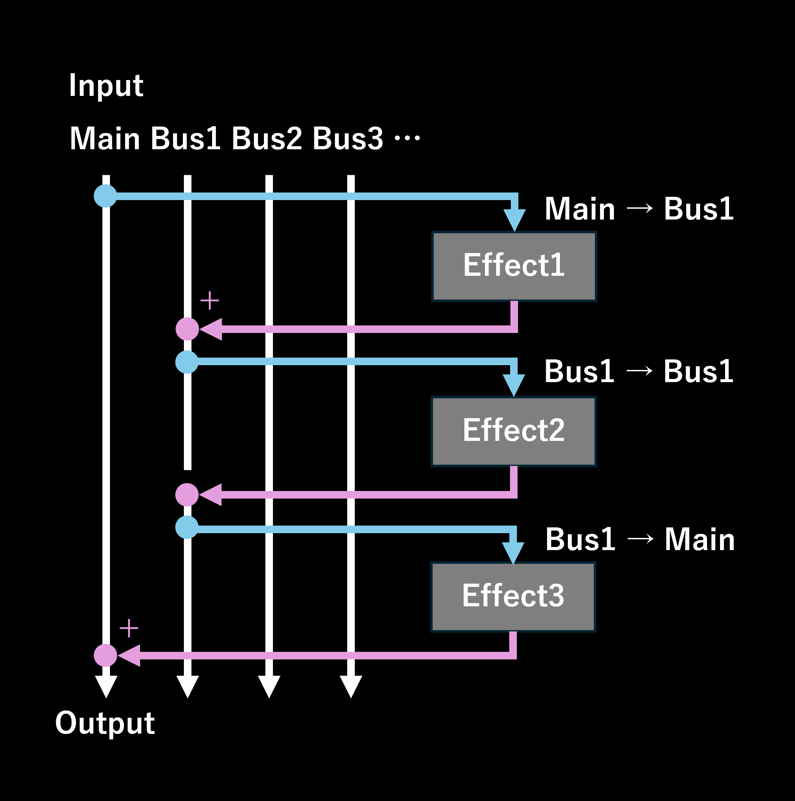

# كيفية استخدام ميزة الناقل

ميزة الناقل تتيح توجيه الصوت بين المؤثرات بمرونة، مما يسمح بمعالجة صوتية أكثر تعقيدًا وتنوعًا.

## المفهوم الأساسي

- كل مؤثر يسمح لك بتحديد **ناقل الإدخال** الذي يستقبل إشارة الصوت التي ستتم معالجتها، و**ناقل الإخراج** الذي يُخرج الصوت المعالج.
- افتراضيًا، إذا لم يُحدد خلاف ذلك، يستخدم كل مؤثر **الناقل الرئيسي** للإدخال والإخراج.
- يمكن استخدام حتى أربعة نواقل إضافية (**الناقل 1 إلى الناقل 4**).

## إعداد نواقل الإدخال والإخراج للمؤثرات

- انقر على **زر التوجيه** الموجود على يسار أزرار الأعلى/الأسفل المعروضة على كل مؤثر.
- يؤدي النقر على زر التوجيه إلى فتح حوار الإعدادات، مما يسمح بالاختيار الحر لناقل الإدخال وناقل الإخراج من الناقل الرئيسي أو الناقل 1 إلى الناقل 4.
- تصبح التغييرات سارية المفعول فورًا.
- لإغلاق الحوار، انقر على زر × في الزاوية العلوية اليمنى أو انقر خارج الحوار.

- إذا تم تعيين إما الإدخال أو الإخراج إلى الناقل 1 أو أعلى، سيتم عرض "الناقل X→الناقل Y" بجانب زر التوجيه.
  - مثال: عند معالجة الصوت من الناقل 2 وإخراجه إلى الناقل 3، سيتم عرض "الناقل 2→الناقل 3".

## آلية معالجة الصوت

- يتم معالجة المؤثرات بشكل تسلسلي من الأعلى إلى الأسفل.
- يأخذ كل مؤثر إشارات الصوت من ناقل الإدخال المحدد، يعالجها، ويرسل النتيجة إلى ناقل الإخراج.
- إذا تم استخدام ناقل الإدخال لأول مرة، تبدأ المعالجة من الصمت.
- إذا كان ناقل الإدخال هو نفسه ناقل الإخراج، يتم الكتابة فوق صوت ناقل الإخراج بالنتيجة المعالجة.
- إذا تم تحديد نواقل مختلفة للإدخال والإخراج، يتم إضافة الصوت المعالج إلى ناقل الإخراج.
- في النهاية، يكون تشغيل الصوت دائمًا من **الناقل الرئيسي**.

[← العودة إلى README](README.md)
