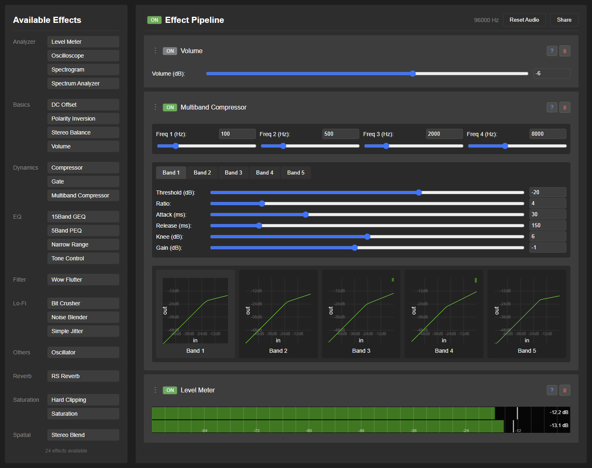
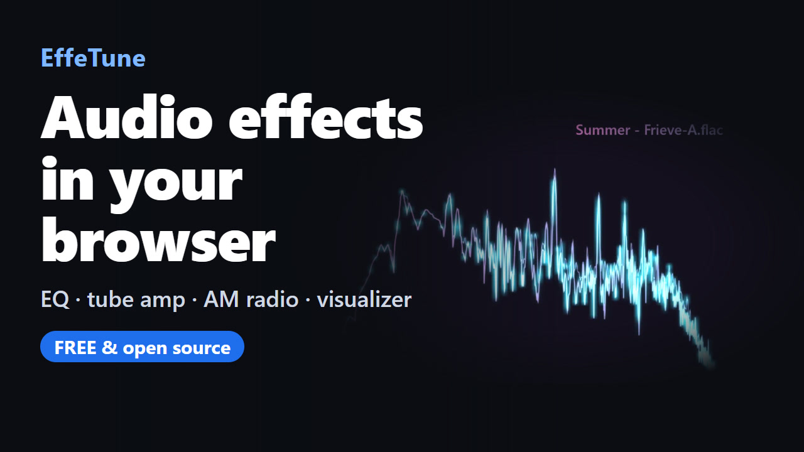

# Frieve EffeTune 

<div class="doc-primary-actions" aria-label="主な操作">
  <a class="button button-primary" href="https://effetune.frieve.com/effetune.html">Webアプリを開く</a>
  <install class="button button-secondary"><a href="https://effetune.frieve.com/effetune.html">PWA版をインストール</a></install>
  <a class="button button-secondary" href="/dsp/">DSP Library</a>
  <a class="button button-secondary" href="https://github.com/Frieve-A/effetune/releases/">デスクトップアプリをダウンロード</a>
  <a class="button button-secondary" href="https://github.com/Frieve-A/effetune-mixwright/releases">VST版をダウンロード</a>
  <a class="button button-secondary" href="https://chromewebstore.google.com/detail/effetune/fhjhnpepnhkcdggogicifibfegpbhibp">Chrome拡張版をインストール</a>
  <a class="button button-secondary" href="https://microsoftedge.microsoft.com/addons/detail/effetune/kjpcfdidpphaclfkfdahchhibgjcngdk">Edge拡張版をインストール</a>
</div>

オーディオ愛好家のためのリアルタイムオーディオエフェクトプロセッサです。EffeTuneを使うと、あらゆるオーディオソースに高品質なエフェクトをかけ、リスニング体験をリアルタイムで好みに合わせて調整できます。

[](https://effetune.frieve.com/effetune.html)

## 紹介動画

[](https://www.youtube.com/watch?v=Qb5Airg0kI8)

## コンセプト

EffeTuneは、音楽をもっと好みの音で楽しみたいオーディオ愛好家のために作られました。ストリーミングで聴く場合でも、物理メディアで再生する場合でも、EffeTuneなら高品質なエフェクトを加え、好みに合わせて音を調整できます。あなたのコンピュータを、オーディオソースとスピーカーまたはアンプの間に置ける強力なオーディオエフェクトプロセッサに変えましょう。

オーディオの迷信ではなく、科学に基づいた音作りを。

## 機能

- リアルタイムオーディオ処理
- エフェクトチェーン構築のためのドラッグ＆ドロップインターフェース
- カテゴリ別に整理された拡張可能なエフェクトシステム
- ライブオーディオビジュアライゼーション
- 音声グラフ、ジャケット画像、曲情報を自由に配置できるVisualizer
- リアルタイムで変更可能なオーディオパイプライン
- 現在のエフェクトチェーンを使用したオフラインオーディオファイル処理
- ローカルのサブフォルダ、メタデータ、プレイリストを閲覧できるMusic Library
- デスクトップアプリ用の、常に手前に表示できるコンパクトなミニプレーヤー
- システムキャリブレーションのための周波数応答測定と補正機能
- マルチチャンネル処理と出力
- スマートフォンやタブレットで使いやすいWebレイアウト

## セットアップガイド

聴きたい音声の再生元に合わせて、以下のセットアップ方法を選んでください。

### 音楽ファイルプレーヤーのセットアップ

- ブラウザでEffeTuneウェブアプリを開く、またはEffeTuneデスクトップアプリを起動する。
- 音楽ファイルを開いて再生し、正常に再生されることを確認する。
   - **音楽ファイルを開く** ボタンを押して、音楽ファイルを選択する。
   - または音楽ファイルを開き、アプリケーションとしてEffeTuneを選択する（デスクトップアプリのみ）。
   - またはファイルメニューから「音楽ファイルを開く...」を選択する（デスクトップアプリのみ）。
   - または音楽ファイルをウィンドウにドラッグする。
- 音楽ファイルプレーヤーだけで使う場合は、オーディオ設定の入力デバイスで「なし（音楽ファイルプレーヤー専用）」を選ぶと、ライブ入力を使わずに再生できます。デスクトップアプリではこれが初期設定です。保存済みの入力デバイス設定がある場合は、その設定を使います。

[音楽プレーヤー](music-player.md)

### デスクトップ版の内蔵ブラウザ

デスクトップ版の **ブラウザ** では、仮想オーディオデバイスを使わずに、Webサイトの音声を現在のエフェクトで加工して聴けます。

1. ヘッダーの **ブラウザ** をクリックします。ブラウザの音声加工が始まります。
2. HTTPまたはHTTPSのアドレスを入力し、サイトの操作でログインして音楽を再生します。先頭の方式を省略したアドレスにはHTTPSが使われます。
3. **Effect Pipeline** に切り替えて音を調整します。画面を切り替えてもブラウザの音声は続きます。

戻る、進む、再読み込み、停止でページを操作できます。**ブックマーク** を開くと、現在のページの追加、保存したページを開く操作、名前の変更、削除ができます。ブラウザメニューには **通常のブラウザで開く**、**開始ページに設定**、**サイトデータを消去** があります。ブックマークと開始ページは保存されます。サイトへのログイン状態は別に保持され、アプリを再起動しても利用できます。ブラウザのページ表示倍率は、アプリのズームに連動します。

**ブラウザ** を開くと、自動でブラウザの音声に切り替わります。ブラウザの音声は、選択中の入力機器の音声と混ぜて再生されます。ブラウザの音声だけを聴くには、入力デバイスを **なし** にしてください。プレーヤーの音声入力設定はブラウザの再生には影響しません。ローカルの音楽ファイルも、ブラウザの音声と同時に再生できます。音声の取り込みが止まった場合は、**ブラウザ** をもう一度押してお試しください。**サイトデータを消去** は、ブックマークを残してサイトの保存データを消去し、ログイン状態を解除します。

ブラウザのツールバーの **閉じる** でブラウザの音声加工を終了し、**Effect Pipeline** に戻ります。ページと閲覧履歴は保持されます。**ブラウザ** を再び開くと、同じページの音声加工を再開します。

**設定 > 環境設定... > ブラウザ** では、次の項目を設定できます。

- **開始ページ**：ブラウザを最初に開くときに表示するHTTPまたはHTTPSアドレスです。入力欄の初期値は空欄で、空欄の場合は[EffeTuneのストリーミング案内ページ](https://effetune.frieve.com/streaming/)が開きます。**リセット** は、現在のページを変えずに入力欄を空にします。
- **新しいタブを既定のブラウザで開く**：初期状態ではオンです。オフにすると、新しいタブのリンクをEffeTuneのブラウザ内で開きます。ログイン用などの別ウィンドウは、どちらの設定でもEffeTune内で開きます。
- **User-Agent**：サイトに伝えるブラウザの識別情報です。既定ではChrome互換のブラウザとして識別され、EffeTuneの名前も含まれます。空欄にするか**リセット**を押すと既定値に戻ります。変更後はブラウザのページを再読み込みしてください。

サイトによっては内蔵ブラウザ、ログイン、保護された音源の再生、音声の取り込みを利用できません。利用可否はサイトとOSに左右され、DRM音源の再生は保証されません。ログインを拒否された場合は、サイトが提供する別のログイン方法を試すか、普段のブラウザを使ってください。普段のブラウザでログインしても、EffeTune内ではログインしたことにはなりません。ブラウザはデスクトップ版専用です。

### ブラウザ拡張版のセットアップ

仮想オーディオデバイスを使わずに、最大4つのChromeまたはEdgeのタブを独立したエフェクトで加工し、URL別プリセットとサンプリング周波数を設定できます。詳しくは[ブラウザ拡張版ガイド](browser-extension.md)をご覧ください。

1. [Chrome](https://chromewebstore.google.com/detail/effetune/fhjhnpepnhkcdggogicifibfegpbhibp)または[Edge](https://microsoftedge.microsoft.com/addons/detail/effetune/kjpcfdidpphaclfkfdahchhibgjcngdk)のストアからEffeTune拡張機能をインストールします。
2. 音声を加工したいタブで再生を開始し、ブラウザのツールバーからEffeTuneを開いて **Start on this tab** を選びます。
3. **Edit pipeline** を選び、エフェクトを追加して音を調整します。

### ストリーミングサービスのセットアップ

ストリーミングサービス（Spotify、YouTube Musicなど）からオーディオを処理するには：

デスクトップ版では、まず[内蔵ブラウザ](#デスクトップ版の内蔵ブラウザ)をお試しください。独立したストリーミングアプリや、内蔵ブラウザで再生できない音源を使う場合は、以下の音声デバイス設定を利用できます。

1. 前提条件：
   - 仮想オーディオデバイスをインストールする（例: VB Cable、Voice Meeter、または ASIO Link Tool）。
   - ストリーミングサービスの出力先を仮想オーディオデバイスに設定する。

2. 設定：
   - ブラウザでEffeTuneウェブアプリを開く、またはEffeTuneデスクトップアプリを起動する。
   - 入力ソースとして仮想オーディオデバイスを選択する。
     - Chromeでは、初めて開いたときにオーディオ入力を選択して許可するダイアログボックスが表示されます。
     - **設定** メニューの **オーディオ設定** から、入出力デバイスやオーディオ形式を選択します。
   - ストリーミングサービスで音楽を再生する。
   - EffeTuneを通じてオーディオが流れていることを確認する。
   - より詳細なセットアップ手順については[FAQ](faq.md)を参照

### 外部オーディオ機器のセットアップ

CDプレーヤー、ネットワークプレーヤー、またはその他の外部オーディオ機器でEffeTuneを使うには：

- オーディオインターフェースをコンピュータに接続する。
- ブラウザでEffeTuneウェブアプリを開く、またはEffeTuneデスクトップアプリを起動する。
- 入力ソースと出力先としてオーディオインターフェースを選択する。
   - Chromeでは、初めて開いたときにオーディオ入力を選択して許可するダイアログボックスが表示されます。
   - **設定** メニューの **オーディオ設定** から、入出力デバイスやオーディオ形式を選択します。
- これにより、オーディオインターフェースは以下のように機能します：
   * **Input:** CDプレーヤー、ネットワークプレーヤー、またはその他のオーディオソース
   * **Processing:** EffeTuneによるリアルタイムエフェクト処理
   * **Output:** アンプまたはスピーカーへ送られる処理済みオーディオ

## 使用方法

初めて起動すると、音楽の再生、エフェクトの追加、音の調整に使う場所を画面に沿って案内します。設定メニューの **画面の案内を見る** から、いつでも見直せます。デスクトップアプリでは **ヘルプ** メニュー、モバイルではメニューボタンからも開けます。

### エフェクトチェーンの作成

1. 画面左側に利用可能なエフェクトの一覧が表示されます。
   - 一覧の横にある検索ボタンを使用してエフェクトを絞り込みます。
   - 名前またはカテゴリでエフェクトを検索するには、任意のテキストを入力してください。
   - ESCキーを押して検索をクリアします。
2. リストからエフェクトをドラッグして、**Effect Pipeline** エリアに配置します。
   - モバイルではエフェクトタブを開き、+ ボタンから全画面リストを表示してエフェクトを追加します。
3. エフェクトは上から下へ順番に処理されます。
4. ハンドル (⋮) をドラッグまたは▲▼ボタンで順序を変更
   - Sectionエフェクトの場合：Shift+▲▼ボタンクリックでセクション全体を移動（あるSectionから次のSection、パイプライン開始、またはパイプライン末尾まで）
5. エフェクト名をクリックし設定の展開・折りたたみ
   - SectionエフェクトでのShift+クリックでそのセクション内の全エフェクトを展開・折りたたみ
   - その他のエフェクトでのShift+クリックでAnalyzerカテゴリー以外の全エフェクトを一括展開・折りたたみ
   - Ctrl+クリックで全エフェクトを一括展開・折りたたみ
6. **ON** ボタンを使用して、個々のエフェクトをバイパスします。
7. ？ボタンをクリックすると、詳細なドキュメントが新しいタブで開きます。
8. ×ボタンを使ってエフェクトを削除します。
   - Sectionエフェクトの場合：Shift+×ボタンクリックでセクション全体を削除
9. ルーティングボタンをクリックして、処理するチャンネルと入出力バスを設定します。
   - [バス機能の詳細](bus-function.md)
10. 各エフェクトのエフェクトプリセットボタンをクリックすると、そのエフェクトだけの設定を保存または適用できます。

### Music Libraryで音楽を探す

端末に保存された音楽ファイルをライブラリとして管理できます。

1. PCではヘッダーの **Music Library** ボタン、モバイルでは **ライブラリ** タブ、デスクトップアプリでは **表示 > Music Library** から開きます。
2. **音楽フォルダを追加** を選び、音楽ファイルが入っているフォルダをインデックス化します。外部CUEシートを使うと、同じフォルダにあるアルバム単位のWAVまたはFLACを曲ごとに分けられます。
3. **曲**、**アルバム**、**アーティスト**、**ジャンル**、**サブフォルダ**、**フォルダ**、**最近追加した曲**、**プレイリスト** から閲覧し、**ライブラリを検索** でコレクションを絞り込みます。
4. **再生** で現在のエフェクトパイプラインを通して聴けます。**次に再生**、**キューに追加**、**プレイリストに追加** で再生を管理できます。
5. ファイルを変更した後は **再スキャン** を使い、ブラウザやフォルダの権限が切れた場合は **再接続** を使います。
   - [Music Libraryの詳細](music-library.md)

### Visualizer

再生中の音楽を元にした可視化を楽しめます。

PCではヘッダー、モバイルでは **プレーヤー** タブ、デスクトップアプリでは **表示** メニューから **Visualizer** を開きます。組み込みのレイアウトを選ぶか、**Edit** で音声グラフ、ジャケット画像、曲情報を配置できます。変更はすぐに反映され、次回起動時にも復元されます。名前を付けて残すにはプリセットダイアログで保存します。表示の上にマウスを置くかタップして **⛶** を選ぶと、アプリのウィンドウいっぱいに表示されます。編集、エフェクト、表示オプションについては[Visualizerガイド](visualizer.md)をご覧ください。

### プリセットの使用

作成したエフェクトパイプラインの保存、読み込みを行います。

Effect Pipelineヘッダーの **パイプラインプリセット** ボタンをクリックすると、プリセットダイアログが開きます。

1. 保存済みプリセットの一覧から選ぶと読み込めます。エフェクトの順序、設定、ON/OFF状態を含むエフェクトチェーン全体が復元されます。
2. 現在のエフェクトチェーンは、名前を入力して **保存** を選ぶと保存できます。
3. 保存済みプリセットは、その行の名前変更ボタンで改名できます。
4. 保存済みプリセットを1つ以上選択し、**選択したプリセットを削除** を選んで確認すると削除できます。
5. Ctrl+S（macOSではCmd+S）を押すと、現在のプリセット名を編集できる状態でダイアログが開きます。

各エフェクトにも専用の **エフェクトプリセット** ボタンがあります。エフェクトにシステムプリセットがあれば表示され、ユーザープリセットの保存、改名、読み込み、削除もできます。エフェクトプリセットで変わるのはそのエフェクトのパラメーターだけで、ON/OFF状態やルーティングは変わりません。

既存の `.effetune_preset` ファイルの読み込み、書き出し、共有は、引き続きエフェクトチェーン全体のプリセットとして機能します。

### エフェクトの共通操作

- スライダーを細かく調整するには、Shiftキーを押しながらドラッグします。値は最小単位ずつ変化します。
   - 負と正の値を取るスライダーは、0から現在値まで塗りつぶされます。Ratioのスライダーは1.0を起点にします。
- 対応する周波数・ノートグラフでは、グラフの軸に沿ってドラッグすると、選んだ周波数をエフェクトチェーン経由で試聴できます。**環境設定 > 一般 > 周波数の試聴音**で、**サイン波**（初期値、-12 dB）または選んだ周波数を中心に帯域を絞った**BPFノイズ**を選べます。Note Spectrogram、Pitch Meter、Chroma Spiralと鍵盤表示の試聴音は常にサイン波です。鍵盤表示では最も近い半音にスナップし、鍵の上をドラッグするとその鍵の音程になります。

[MIDI、ゲームパッド、キーボードでエフェクトを操作する](controller-mapping.md)

### セクション機能の使用方法

複数のエフェクトをグループ化して扱います。

1. **Sectionエフェクトの使用：**
   - グループ化したいエフェクト群の先頭にSectionエフェクトを配置する。
   - Commentフィールドに分かりやすい名前を入力する。
   - SectionのON/OFFを切り替えると、各エフェクト自身のON/OFF状態を保ったまま、そのセクション全体をバイパスまたは復帰できる。
   - 複数のSectionエフェクトを使用して、エフェクトチェーンを論理的なグループに整理する。
   - [制御エフェクトの詳細](plugins/control.md)

### ABパイプライン機能の使用

2つのエフェクトパイプラインを切り替えて聞き比べます。

1. **ABパイプライン概要：**
   - EffeTuneでは2つの独立したエフェクトパイプライン（パイプラインAとパイプラインB）を使えます。
   - 起動時はパイプラインAのみが読み込まれ、パイプラインBは必要に応じて作成されます。
   - すべての処理、保存、読み込み、編集操作は現在選択されているパイプラインで動作します。

2. **AB切り替えボタン：**
   - Effect Pipelineヘッダーの右側に配置されています。
   - デフォルトで「A」を表示（パイプラインAがアクティブ）
   - クリックしてパイプラインAとパイプラインBを切り替えます。
   - パイプラインBが存在しない状態で切り替えると、パイプラインAの設定がパイプラインBにコピーされます。

3. **ABメニュー（ドロップダウンボタン）：**
   - AB切り替えボタンの右側に配置されています。
   - 「A → B」：パイプラインAの設定をパイプラインBにコピーしてパイプラインBに切り替えます。
   - 「B → A」：パイプラインBの設定をパイプラインAにコピーしてパイプラインAに切り替えます。

4. **ブラインドテスト：**
   - どちらが再生されているか分からない状態で、パイプラインAとパイプラインBを聴き比べます。
   - ABXテストで2つのパイプラインを本当に聞き分けられるかを確認したり、A/B比較テストでどちらが好みかを判定したりでき、統計的有意性も確認できます。
   - A/B切り替えボタン右の▼パイプラインメニューから開きます（デスクトップアプリではファイルメニューからも開けます）。
   - [ブラインドテストの詳細](double-blind-test.md)

### エフェクト選択とキーボードショートカット

1. **エフェクト選択方法：**
   - エフェクトのヘッダーをクリックして個々のエフェクトを選択する。
   - Ctrlキーを押しながらクリックすると、複数のエフェクトを選択できる。
   - Pipelineエリアの空白部分をクリックして、すべてのエフェクトの選択を解除する。

2. **キーボードショートカット：**
   - Ctrl + Z: 元に戻す
   - Ctrl + Y: やり直す
   - Ctrl + S: 現在のパイプラインを保存
   - Ctrl + Shift + S: 現在のパイプラインを別名で保存
   - Ctrl + X: 選択したエフェクトを切り取る
   - Ctrl + C: 選択したエフェクトをコピー
   - Ctrl + V: クリップボードからエフェクトを貼り付ける
   - Ctrl + F: エフェクトを検索する
   - Ctrl + A: パイプライン内のすべてのエフェクトを選択する
   - Delete: 選択したエフェクトを削除する
   - ESC: すべてのエフェクトの選択を解除する
   - T: パイプラインAとパイプラインBを切り替える
   - A: パイプラインAに切り替える
   - B: パイプラインBに切り替える

3. **キーボードショートカット（プレーヤー使用時）**：
   - Space：再生/一時停止
   - Ctrl + → または N：次のトラック
   - Ctrl + ← または P：前のトラック
   - Shift + → または F または .：10秒早送り
   - Shift + ← または R または ,：10秒巻き戻し
   - Ctrl + M：リピートモード切り替え
   - Ctrl + H：シャッフルモード切り替え
   - T：パイプラインA/Bを切り替える
   - A：パイプラインAに切り替える
   - B：パイプラインBに切り替える

### オーディオファイルの処理

音楽ファイルをエフェクトチェーンで加工し、新しいファイルとして保存できます。

1. **ファイルドロップまたはファイル指定エリア：**
   - **Effect Pipeline** の下に常に表示される専用のドロップエリア
   - 単一または複数のオーディオファイルに対応
   - ファイルは現在のパイプライン設定で処理される。
   - エフェクトはパイプラインのサンプルレートで処理され、出力サンプルレートへの変換はその後に行われる。

2. **処理状況：**
   - プログレスバーが現在の処理状況を表示する。
   - 処理時間はファイルサイズとエフェクトチェーンの複雑さに依存する。

3. **ダウンロードまたは保存オプション：**
   - **設定 > 環境設定... > オフラインファイル出力** でWAVまたはFLACを選び、サンプルレートと品質を設定できる。FLACは16-bitまたは24-bitのロスレスを選択できる。初期値は96 kHz、24-bit PCMのWAV
   - 形式ごとにチャンネル数の上限が異なる。選択した形式の上限を超えるファイルは自動的にダウンミックスせず、対処方法を表示して停止する。
   - 複数ファイルの場合、処理開始前に出力フォルダを選択し、各ファイルは完了次第そのフォルダへ直接保存される。
   - フォルダ選択に対応していない古いブラウザでは、複数ファイルはZIPファイルにまとめてダウンロードされる。

### エフェクトチェーンの共有

他のユーザーとエフェクトチェーンの設定を共有できます。
1. 希望のエフェクトチェーンを設定したら、**Effect Pipeline** エリアの右上にある **共有** ボタンをクリックする。
2. ウェブアプリのURLが自動的にクリップボードにコピーされる。
3. コピーされたURLを他のユーザーと共有する ― 共有されたURLを開くことで、まったく同じエフェクトチェーンを再現できます。
4. 共有URLには再現に必要なエフェクト設定が保存されます。通常の作業状態はWebアプリがブラウザ内にも保存します。
5. デスクトップアプリ版では、ファイルメニューから`.effetune_preset` ファイルに設定をエクスポートできます。
6. エクスポートした`.effetune_preset` ファイルを共有してください。`.effetune_preset` ファイルはウェブアプリウィンドウにドラッグして読み込むこともできます。

### 保存データのバックアップと復元

**設定 > バックアップ / 復元** を開くと、保存済みのパイプラインプリセット、エフェクトプリセット、インパルス応答、測定結果を、ウェブアプリ、デスクトップアプリ、ブラウザ拡張の間で移行できます。ウェブアプリとデスクトップアプリでは、名前を付けて保存したVisualizerプリセットも含められます。プリセットを選ぶと、そのプリセットが使う測定データやインパルス応答データも自動で選択されます。

**測定データを含める** と **インパルス応答データを含める** は初期状態でオンになっており、バックアップだけで復元が完結します。どちらかをオフにするのは、復元先に同じ測定ファイルやインパルス応答ファイルがすでにある場合だけにしてください。復元したインパルス応答はEffeTuneの **Impulse Response Library** に追加されます。バックアップを復元しても、現在のパイプライン、音量、選択中のプリセット、デバイス設定、Music Library、拡張機能のURLルールは変わりません。`.effetune_backup` ファイル1つの上限は256 MBです。これを超える場合は、必要に応じて複数のファイルに分けてください。復元が途中で止まっても完了した項目は残り、同じファイルで安全に復元し直せます。

バックアップを共有する前に、選択内容を確認してください。プリセット名やコメント、元のインパルス応答ファイル、測定の詳細が含まれることがあります。音楽ファイル、Music Libraryのデータ、アプリの設定、デバイスの選択、URLルール、認証情報、保存していない現在のパイプラインは含まれません。

### アプリケーション設定

**設定 > 環境設定...** では、**言語**の選択、**起動時の表示:**（`Effect Pipeline (デフォルト)`、`Music Library`、`Visualizer`）と **起動時のエフェクトパイプライン:** の設定、**テーマ**（`Graphite`、`Paper`、`Midnight`、`Ember`、`Mint`）の選択ができます。**起動時の表示:** を **Music Library** にした場合は、最初に開くライブラリのカテゴリも選べます。 デスクトップ版では、起動時の表示に **Browser** も選べます。

**エフェクトパイプラインの列数**で **手動**を選ぶと、＋／−ボタンで列数を調整できます。**自動**（初期設定）を選ぶと、エフェクト一覧と合わせてウィンドウの幅に収まるように列数が決まり、ウィンドウのサイズを変えるたびに調整されます。

Microsoft Store版の更新はMicrosoft Storeで管理されます。**設定 > 環境設定...** の **Microsoft Storeの更新画面を開く** で更新を確認し、**Windowsのスタートアップ設定を開く** で自動起動するかどうかを設定できます。設定やBrowserのログイン情報は、ほかのデスクトップ版とは別に保存されます。

### 周波数応答測定と補正

マイクでオーディオシステムを測定し、EffeTuneに読み込める補正EQを作成できます。詳しくは[周波数応答測定と補正](measurement.md)と[Pipeline Analyzerガイド](pipeline-analyzer.md)をご覧ください。

### オーディオのリセット

オーディオの問題（ドロップアウト、グリッチ）が発生した場合：
1. **設定** メニューまたはモバイルのオーバーフローメニューから **オーディオをリセット** を選択します。デスクトップアプリでは **表示** メニューの **リロード** も使えます。
2. オーディオパイプラインが自動的に再構築される。
3. エフェクトチェーンの設定は保持される。

### OpenHomeリモート操作（デスクトップ版）

対応するデスクトップ版は、同じLAN上のOpenHomeアプリから操作できます。初期状態では無効です。設定方法、ネットワーク公開、互換性、制約については[OpenHomeリモート操作](openhome.md)を参照してください。

### AIアシスタントから操作する（MCP）

CodexやClaude CodeにMCPのセットアップを任せると、EffeTuneデスクトップ版のエフェクト追加、設定変更、プリセットの読み込み・保存を依頼できます。お使いのコンピュータでコマンドを実行できるエージェントを利用してください。

1. EffeTuneデスクトップ版の **設定 > リモートコントロール...** を開き、**リモート操作を許可する** を有効にして、**リンクをコピー** を押します。
2. 次のプロンプトのリンク欄をコピーしたリンクに置き換え、AIエージェントへ送ってください。

```text
以下の公式手順に従ってEffeTune MCPをセットアップしてください。
https://github.com/Frieve-A/effetune/blob/main/mcp/README.md
接続用リンク: <コピーしたリンクをここに貼り付ける>
```

セットアップ後は、必要に応じて案内された再起動を行い、「現在のエフェクトを教えて」と依頼してみてください。接続用リンクは公開しないでください。**接続コードを更新** を押したりポートを変更したりした場合は、新しいリンクでセットアップし直します。

## よく使われるエフェクトの組み合わせ

あなたのリスニング体験を向上させるための人気のエフェクト組み合わせをいくつかご紹介します：

### ヘッドホン強化

1. Stereo Blend -> RS Reverb  
   - **Stereo Blend:** 快適な音場を実現するためにステレオ幅を調整する (60-100%)。
   - **RS Reverb:** 控えめな部屋の響きを追加する (10-20% mix)。
   - **結果:** より自然で耳が疲れにくいヘッドホンでのリスニング体験

### レコード風シミュレーション

1. Wow Flutter -> Noise Blender -> Saturation  
   - **Wow Flutter:** やわらかなピッチの変動を加える。
   - **Noise Blender:** レコードらしい雰囲気を作り出す。
   - **Saturation:** アナログ的な温かみを加える。
   - **結果:** 本物らしいレコード再生の雰囲気

### FMラジオ風

1. Multiband Compressor -> Stereo Blend  
   - **Multiband Compressor:** ラジオ風のサウンドを作り出す。
   - **Stereo Blend:** 快適な音場のためにステレオ幅を調整する (100-150%)。
   - **結果:** FMラジオ風に整ったサウンド

### ローファイ感

1. Bit Crusher -> Simple Jitter -> RS Reverb  
   - **Bit Crusher:** レトロな雰囲気のためにビット深度を削減する。
   - **Simple Jitter:** デジタルな不完全さを加える。
   - **RS Reverb:** 雰囲気のある空間を作り出す。
   - **結果:** 昔ながらのローファイ感

## トラブルシューティングとFAQ

何らかの問題が発生している場合は[トラブルシューティングとFAQ](faq.md)をご参照ください。

問題が解決されない場合は[GitHub Issues](https://github.com/Frieve-A/effetune/issues)にご報告ください。

## 利用可能なエフェクト

| カテゴリ    | エフェクト             | 説明                                                                  | ドキュメント                                             |
|-----------|---------------------|---------------------------------------------------------------------|---------------------------------------------------------|
| Analyzer  | Analog Meter        | VU・PPM・ピーク・ラウドネスに対応した指針メーターでレベルを表示 | [詳細](plugins/analyzer.md#analog-meter)              |
| Analyzer  | Chroma Spiral       | 各音名の強さを1周1オクターブの渦巻きで表示                                         | [詳細](plugins/analyzer.md#chroma-spiral)             |
| Analyzer  | Level Meter         | ピークホールド機能付きのオーディオレベルを表示                                     | [詳細](plugins/analyzer.md#level-meter)               |
| Analyzer  | Note Spectrogram | 推定した音高を時間に沿ったピアノロールで表示                                       | [詳細](plugins/analyzer.md#note-spectrogram)       |
| Analyzer  | Oscilloscope        | リアルタイムで波形を可視化                                                   | [詳細](plugins/analyzer.md#oscilloscope)              |
| Analyzer  | Pitch Meter | 1つの基音とチューニングの変化を表示                                                    | [詳細](plugins/analyzer.md#pitch-meter)             |
| Analyzer  | Rhythm Analyzer | テンポ、1拍ごとの発音、各パートの走り・もたりを表示 | [詳細](plugins/analyzer.md#rhythm-analyzer) |
| Analyzer  | Spectrogram         | 時間経過に伴う周波数スペクトルの変化を表示                                         | [詳細](plugins/analyzer.md#spectrogram)               |
| Analyzer  | Spectrum Analyzer   | 低域・中域・高域の強さをリアルタイムに表示                                                  | [詳細](plugins/analyzer.md#spectrum-analyzer)         |
| Analyzer  | Stereo Meter        | ステレオバランスとチャンネル相関を可視化                                              | [詳細](plugins/analyzer.md#stereo-meter)              |
| Basics    | Bass Management     | 低域を1台以上のサブウーファーへ振り分け、LFEをメインチャンネルの低域と合算 | [詳細](plugins/basics.md#bass-management)             |
| Basics    | Channel Divider     | ステレオ信号を周波数帯域に分割し、各帯域を別々のステレオ出力ペアへルーティング                         | [詳細](plugins/basics.md#channel-divider)             |
| Basics    | DC Offset           | DCオフセットの調整                                                        | [詳細](plugins/basics.md#dc-offset)                   |
| Basics    | FIR Crossover       | 急峻に分割した周波数帯域をステレオ出力ペアへ送るFIRクロスオーバー | [詳細](plugins/basics.md#fir-crossover) |
| Basics    | Matrix              | オーディオチャンネルを柔軟に割り当て、混ぜ合わせる                                  | [詳細](plugins/basics.md#matrix)                      |
| Basics    | MultiChannel Panel  | 複数チャンネルを音量、ミュート、ソロ、遅延で個別制御するコントロールパネル                   | [詳細](plugins/basics.md#multichannel-panel)          |
| Basics    | Mute                | オーディオ信号を完全に無音化                                                   | [詳細](plugins/basics.md#mute)                        |
| Basics    | Polarity Inversion  | 信号の極性を反転                                                          | [詳細](plugins/basics.md#polarity-inversion)          |
| Basics    | Stereo Balance      | ステレオチャンネルのバランスを制御                                              | [詳細](plugins/basics.md#stereo-balance)              |
| Basics    | Volume              | 基本的なボリューム制御                                                       | [詳細](plugins/basics.md#volume)                      |
| Delay     | Delay          | 標準的なディレイエフェクト                                   | [詳細](plugins/delay.md#delay) |
| Delay     | Time Alignment | スピーカーやリスニング位置の調整に使う再生タイミングを微調整 | [詳細](plugins/delay.md#time-alignment) |
| Dynamics  | Attack Tonal Balance | 短いアタックと持続する音程感のバランスを調整 | [詳細](plugins/dynamics.md#attack-tonal-balance) |
| Dynamics  | Auto Leveler | 一貫したリスニング体験のためにLUFS測定に基づいて自動的に音量を調整 | [詳細](plugins/dynamics.md#auto-leveler) |
| Dynamics  | Brickwall Limiter | 信号ピークを抑えてデジタルクリッピングを防ぐ | [詳細](plugins/dynamics.md#brickwall-limiter) |
| Dynamics  | Compressor | 急に大きくなる部分をなめらかにし、より聴きやすくする | [詳細](plugins/dynamics.md#compressor) |
| Dynamics  | Expander | しきい値以下の静かな音をさらに抑え、自然な強弱のコントラストを取り戻す | [詳細](plugins/dynamics.md#expander) |
| Dynamics  | Gate | 無音部や静かな部分の小さな音を抑える | [詳細](plugins/dynamics.md#gate) |
| Dynamics  | Multiband Compressor | 安定したラジオ風のリスニングサウンドに整える5バンド音量バランス処理 | [詳細](plugins/dynamics.md#multiband-compressor) |
| Dynamics  | Multiband Expander | 平坦に感じる録音の自然なコントラストを戻す5バンドエクスパンダー | [詳細](plugins/dynamics.md#multiband-expander) |
| Dynamics  | Multiband Transient | 低域・中域・高域のアタックとサステインを個別に整える | [詳細](plugins/dynamics.md#multiband-transient) |
| Dynamics  | Power Amp Sag | 高負荷時のパワーアンプの電圧降下をシミュレート | [詳細](plugins/dynamics.md#power-amp-sag) |
| Dynamics  | Transient Shaper | アタックとサステインを整え、音楽のパンチや厚みを調整 | [詳細](plugins/dynamics.md#transient-shaper) |
| EQ        | 15Band GEQ | 15バンドグラフィックイコライザー | [詳細](plugins/eq.md#15band-geq) |
| EQ        | 15Band PEQ | リスニング用の細かな音色調整に使える15バンドパラメトリックイコライザー | [詳細](plugins/eq.md#15band-peq) |
| EQ        | 5Band Dynamic EQ | しきい値に基づく周波数調整が可能な5バンドダイナミックイコライザー | [詳細](plugins/eq.md#5band-dynamic-eq) |
| EQ        | 5Band FIR PEQ | Minimum PhaseまたはLinear PhaseのFIRフィルターで音色を整える5バンドパラメトリックイコライザー | [詳細](plugins/eq.md#5band-fir-peq) |
| EQ        | 5Band PEQ | 低域・中域・高域を整えやすい柔軟な5バンドイコライザー | [詳細](plugins/eq.md#5band-peq) |
| EQ        | Band Pass Filter | 特定の周波数に焦点を当てる | [詳細](plugins/eq.md#band-pass-filter) |
| EQ        | Comb Filter | フェイザー風、空洞感、金属的な色づきを追加 | [詳細](plugins/eq.md#comb-filter) |
| EQ        | Earphone Cable Sim | 通常範囲のイヤホンケーブル差による周波数特性変化の小ささを確認 | [詳細](plugins/eq.md#earphone-cable-sim) |
| EQ        | Group Delay EQ | 音色を変えずに帯域ごとの遅延を調整 | [詳細](plugins/eq.md#group-delay-eq) |
| EQ        | Group Delay PEQ | 音色を変えずに周波数ごとの遅延を5バンドのパラメトリック操作で調整 | [詳細](plugins/eq.md#group-delay-peq) |
| EQ        | Hi Pass Filter | 不要な低域を精密に除去 | [詳細](plugins/eq.md#hi-pass-filter) |
| EQ        | Lo Pass Filter | 不要な高域を精密に除去 | [詳細](plugins/eq.md#lo-pass-filter) |
| EQ        | Loudness Equalizer | 低音量リスニング向けの周波数バランス補正 | [詳細](plugins/eq.md#loudness-equalizer) |
| EQ        | Narrow Range | ハイパスフィルターとローパスフィルターの組み合わせ | [詳細](plugins/eq.md#narrow-range) |
| EQ        | Room EQ      | 保存した室内測定に基づくFIR補正 | [詳細](plugins/eq.md#room-eq) |
| EQ        | Tilt EQ      | クイックトーンシェイピング用のチルトイコライザー      | [詳細](plugins/eq.md#tilt-eq)      |
| EQ        | Tonal Balance EQ | 長期的な音色バランスを音楽スタイルごとの目標へ自動補正 | [詳細](plugins/eq.md#tonal-balance-eq) |
| EQ        | Tone Control | 3バンドトーンコントロール | [詳細](plugins/eq.md#tone-control) |
| Lo-Fi     | AM Radio Simulator | 音楽をモデル化したAM放送・受信機チェーンで変換 | [詳細](plugins/lofi.md#am-radio-simulator) |
| Lo-Fi     | Bit Crusher | ビット深度削減とゼロオーダーホールド効果 | [詳細](plugins/lofi.md#bit-crusher) |
| Lo-Fi     | Cassette Artifacts | 音楽をモデル化したコンパクトカセットに録音し、Type I/II/IVとDolby B/Cを備えたデッキで再生 | [詳細](plugins/lofi.md#cassette-artifacts) |
| Lo-Fi     | Digital Error Emulator | 様々なデジタルオーディオ伝送エラーとビンテージデジタル機器の特性をシミュレート | [詳細](plugins/lofi.md#digital-error-emulator) |
| Lo-Fi     | DSD64 IMD Simulator | DSD64の超音波ノイズに由来する可聴域の相互変調歪み（IMD）をシミュレート | [詳細](plugins/lofi.md#dsd64-imd-simulator) |
| Lo-Fi     | FM Radio Simulator | 音楽を物理シミュレーションによるFM放送・受信機チェーンで変換 | [詳細](plugins/lofi.md#fm-radio-simulator) |
| Lo-Fi     | G.726 Simulator | ITU-T G.726音声コーデックのエンコード/デコード往復を、任意のノイズのある無線区間付きで再現 | [詳細](plugins/lofi.md#g726-simulator) |
| Lo-Fi     | GSM-FR Simulator | 13 kbit/s GSM-FR音声コーデックのエンコード/デコード往復を、フレーム消失の隠蔽を伴う無線区間付きで再現 | [詳細](plugins/lofi.md#gsm-fr-simulator) |
| Lo-Fi     | Hum Generator | ビンテージ/ローファイ風の50/60 Hz電源ハムの雰囲気を調整して追加 | [詳細](plugins/lofi.md#hum-generator) |
| Lo-Fi     | MD Simulator | MiniDisc時代のATRACエンコード/デコード往復を再現 | [詳細](plugins/lofi.md#md-simulator) |
| Lo-Fi     | MP3 Codec Simulator | 低ビットレートMPEG Layer IIIのクリーンなエンコード/デコード往復を再現 | [詳細](plugins/lofi.md#mp3-codec-simulator) |
| Lo-Fi     | Noise Blender | ローファイな雰囲気のための背景ノイズ質感を調整して追加 | [詳細](plugins/lofi.md#noise-blender) |
| Lo-Fi     | SBC Codec Simulator | Bluetooth A2DP SBCのエンコード/デコード往復を、任意のパケット消失と隠蔽付きで再現 | [詳細](plugins/lofi.md#sbc-codec-simulator) |
| Lo-Fi     | Simple Jitter | デジタルジッターシミュレーション | [詳細](plugins/lofi.md#simple-jitter) |
| Lo-Fi     | SW Radio Simulator | 音楽をモデル化した短波放送・電離層伝搬・受信機チェーンで変換 | [詳細](plugins/lofi.md#sw-radio-simulator) |
| Lo-Fi     | Tape Artifacts | 音楽をモデル化したオープンリールテープに録音して再生 | [詳細](plugins/lofi.md#tape-artifacts) |
| Lo-Fi     | TV Audio Simulator | 音楽をモデル化したアナログテレビ放送とNICAMデジタルテレビ放送の音声経路に通す | [詳細](plugins/lofi.md#tv-audio-simulator) |
| Lo-Fi     | Vinyl Artifacts | レコード風のポップノイズ、クラックル、ヒス、ランブル、ステレオノイズ漏れを追加 | [詳細](plugins/lofi.md#vinyl-artifacts) |
| Lo-Fi     | Vinyl Simulator | 入力をモデル化した溝にカッティングし、物理的な針モデルで再生 | [詳細](plugins/lofi.md#vinyl-simulator) |
| Modulation | Auto Filter | LFOまたは音量エンベロープで共振フィルターをスイープ | [詳細](plugins/modulation.md#auto-filter) |
| Modulation | Auto Pan | ステレオペアの音量を左右へなめらかに移動 | [詳細](plugins/modulation.md#auto-pan) |
| Modulation | Chorus | コーラス、アンサンブル、フランジャー、ビブラートの揺らぎを追加 | [詳細](plugins/modulation.md#chorus) |
| Modulation | Doppler Distortion | スピーカーコーンの微細な動きによる自然でダイナミックな音変化をシミュレート | [詳細](plugins/modulation.md#doppler-distortion) |
| Modulation | Frequency Shifter | 周波数移動、リング変調、バーバーポールシフトを適用 | [詳細](plugins/modulation.md#frequency-shifter) |
| Modulation | Phaser | クラシックまたはバーバーポール方式のピークとノッチの動きを生成 | [詳細](plugins/modulation.md#phaser) |
| Modulation | Pitch Shifter | テンポを変えずに音楽のピッチを上げ下げ | [詳細](plugins/modulation.md#pitch-shifter) |
| Modulation | Pitch Shifter HQ | 位相の乱れによる音のにじみを抑えてピッチを上げ下げ | [詳細](plugins/modulation.md#pitch-shifter-hq) |
| Modulation | Rotary Speaker | ホーンとドラムの異なる回転を組み合わせたロータリースピーカー効果 | [詳細](plugins/modulation.md#rotary-speaker) |
| Modulation | Tremolo | 音量ベースのモジュレーション効果 | [詳細](plugins/modulation.md#tremolo) |
| Modulation | Wow Flutter | テープやレコード風のさりげないピッチ揺れでビンテージ感を追加 | [詳細](plugins/modulation.md#wow-flutter) |
| Resonator | Adaptive Prediction | 音声の予測を学習し、残差の抽出や変化する共鳴音の生成に使います | [詳細](plugins/resonator.md#adaptive-prediction) |
| Resonator | Horn Resonator | カスタマイズ可能な寸法でのホーン共振シミュレーション | [詳細](plugins/resonator.md#horn-resonator) |
| Resonator | Horn Resonator Plus | より滑らかなホーンスピーカー共振で自然なリスニング向けの色づきを追加 | [詳細](plugins/resonator.md#horn-resonator-plus) |
| Resonator | Modal Resonator | 最大5つのレゾネーターを備えた周波数共振効果 | [詳細](plugins/resonator.md#modal-resonator) |
| Restoration | Click Remover | 短いクリック、パチパチ音、ポップノイズ、音切れを修復 | [詳細](plugins/restoration.md#click-remover) |
| Restoration | Clip Restorer | ハードクリップで平らになったピークを復元 | [詳細](plugins/restoration.md#clip-restorer) |
| Restoration | Hum Remover | 一定した電気的ハムとその倍音を抑制 | [詳細](plugins/restoration.md#hum-remover) |
| Restoration | Noise Reduction | 音楽を保ちながら、一定して続く背景ノイズを抑制 | [詳細](plugins/restoration.md#noise-reduction) |
| Reverb    | Dattorro Plate Reverb | Dattorroアルゴリズムに基づくクラシックなプレートリバーブ | [詳細](plugins/reverb.md#dattorro-plate-reverb) |
| Reverb    | FDN Reverb | リッチで密度の高いリバーブテクスチャを生成するフィードバック・ディレイ・ネットワーク・リバーブ | [詳細](plugins/reverb.md#fdn-reverb) |
| Reverb    | IR Reverb | 取り込んだ部屋や機器のインパルス応答を使うコンボリューションリバーブ | [詳細](plugins/reverb.md#ir-reverb) |
| Reverb    | RS Reverb | 自然な拡散を伴うランダム散乱リバーブ | [詳細](plugins/reverb.md#rs-reverb) |
| Saturation| Bandwidth Extender | 検出または指定したカットオフより上に高域成分を生成 | [詳細](plugins/saturation.md#bandwidth-extender) |
| Saturation| Bass Extender | 適した低域成分から1オクターブ下の低音を生成 | [詳細](plugins/saturation.md#bass-extender) |
| Saturation| Dynamic Saturation | スピーカーコーンの非線形変位をシミュレート | [詳細](plugins/saturation.md#dynamic-saturation) |
| Saturation| Exciter | 明瞭さと存在感を高める倍音成分を追加 | [詳細](plugins/saturation.md#exciter) |
| Saturation| Hard Clipping | デジタルハードクリッピング効果 | [詳細](plugins/saturation.md#hard-clipping) |
| Saturation | Harmonic Distortion | 2次から5次の倍音歪みを調整してキャラクターを追加 | [詳細](plugins/saturation.md#harmonic-distortion) |
| Saturation| Multiband Saturation | 低域・中域・高域に温かみやエッジを別々に追加 | [詳細](plugins/saturation.md#multiband-saturation) |
| Saturation| Saturation | アナログ風の温かい豊かさとキャラクターを追加 | [詳細](plugins/saturation.md#saturation) |
| Saturation| Sub Synth | ベース強化のため、フィルター処理した低周波信号をミックス | [詳細](plugins/saturation.md#sub-synth) |
| Saturation| Tube Simulator | 真空管ライン段と、プッシュプルまたはシングルエンド三極管（300B/2A3）のパワーアンプをモデル化 | [詳細](plugins/saturation.md#tube-simulator) |
| Spatial   | Crossfeed Filter | 自然なステレオイメージのためのヘッドホン用クロスフィードフィルター | [詳細](plugins/spatial.md#crossfeed-filter) |
| Spatial   | Crosstalk Cancellation | 耳元の測定値を使ってステレオスピーカー間のクロストークを低減 | [詳細](plugins/spatial.md#crosstalk-cancellation) |
| Spatial   | MS Matrix | 中央と左右の響きを調整するため、ステレオとMid/Sideを相互変換 | [詳細](plugins/spatial.md#ms-matrix) |
| Spatial   | Multiband Balance | 5バンド周波数依存のステレオバランス制御 | [詳細](plugins/spatial.md#multiband-balance) |
| Spatial   | Phase Select EQ | L/R位相差とBalanceで選んだ周波数成分をブーストまたはカット | [詳細](plugins/spatial.md#phase-select-eq) |
| Spatial   | Spatial Mapper | 音をDirect、Diffuse、Residualに分けて柔軟にマルチチャンネルへルーティング | [詳細](plugins/spatial.md#spatial-mapper) |
| Spatial   | Stereo Blend | 極性反転ステレオからモノラルを経て拡張ステレオまでステレオ幅を制御 | [詳細](plugins/spatial.md#stereo-blend) |
| Others    | Oscillator | スピーカーやヘッドホン確認用のテストトーン/ノイズジェネレーター | [詳細](plugins/others.md#oscillator) |
| Others    | SFZ Note Player | 検出したノートを取り込んだ SFZ 音源で再生 | [詳細](plugins/others.md#sfz-note-player) |
| Control   | Section | 複数のエフェクトをグループ化し、セクション全体をバイパスまたは復帰 | [詳細](plugins/control.md) |

## 技術情報

### ブラウザ互換性

Frieve EffeTuneはGoogle Chromeで動作確認済みです。本アプリケーションには、以下の機能をサポートする最新のブラウザが必要です：
- Web Audio API
- Audio Worklet
- getUserMedia API
- Drag and Drop API
- Service Worker（インストール可能なWebアプリとオフライン起動用）

### ブラウザサポートの詳細

1. Chrome/Chromium
   - 正式にサポートしており、推奨ブラウザです。
   - 最適なパフォーマンスのために最新バージョンに更新してください。

2. Firefox/Safari
   - サポートは限定的です。
   - 出力デバイス選択、Wake Lock、インストール動作、対応オーディオ形式などはブラウザによって異なります。
   - 最良の体験のためにChromeの使用を検討してください。

### 推奨サンプルレート

EffeTuneの **サンプルレート** は96 kHzに設定してください。サチュレーションなどの非線形エフェクトで生じる、耳に聞こえるエイリアシング（折り返し）を減らせます。この設定はEffeTune内部の処理レートを決めるもので、OS、オーディオインターフェース、仮想オーディオデバイスのサンプルレートとは独立して働きます。アプリに表示される実際のサンプルレートを確認してください。設定を保存するまではOSまたはブラウザの既定値に従うことがあり、ウェブアプリでは96 kHzを使えない場合に別のレートへ切り替わることがあります。音が途切れる場合は、まず負荷の高いエフェクトを無効にするかチェーンを短くし、必要な場合にだけサンプルレートを下げてください。

## 開発ガイド

[](https://deepwiki.com/Frieve-A/effetune)

自分だけのオーディオプラグインを作成してみたいですか？ 詳細は[プラグイン開発ガイド](../../plugin-development.md)をご覧ください。

## DSPライブラリ

EffeTuneのDSPエンジンは、Python、JavaScript、ブラウザのAudioWorklet向けの、独立した決定論的なMITライセンスのライブラリとしても使えます。公開されているChainスキーマと自動生成のエフェクトカタログは、EffeTuneアプリがなくても利用できます。詳しくは[EffeTune DSP Libraryのドキュメント](https://effetune.frieve.com/dsp/)をご覧ください。

インストール方法と、そのまま実行できるサンプルは、各パッケージのクイックスタートにあります。

- [Pythonパッケージ](https://effetune.frieve.com/dsp/getting-started/python/)
- [JavaScript・AudioWorkletパッケージ](https://effetune.frieve.com/dsp/getting-started/javascript/)

エフェクト、スキーマ、処理の動作、必要なアセットについては[DSP Libraryガイド](https://effetune.frieve.com/dsp/)で説明しています。

## リンク

[バージョン履歴](../../version-history.md)

[ソースコード](https://github.com/Frieve-A/effetune)

[YouTube](https://www.youtube.com/@frieveamusic)

[Discord](https://discord.gg/gf95v3Gza2)

[Ko-fiで支援する](https://ko-fi.com/frievea)
